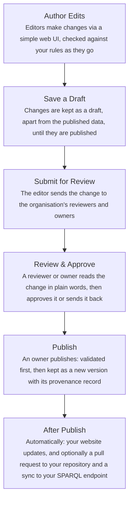

::product-page-logo{src="/img/logo-k-maker.png" alt="K-Maker"}
::

# K-Maker

_K-Maker is KurrawongAI's [Knowledge Graph](https://en.wikipedia.org/wiki/Knowledge_graph) creation and maintenance application—providing specialised functions to create and govern data as standards-compliant Knowledge Graphs. For reference data management in particular, these graphs are then readily available to other applications._

---
<figure style="float:right; width:250px; margin-left:75px;">
  
  <figcaption>Turn loose pile of information into well-organised data</figcaption>
</figure>

## Challenges for enterprise reference data

Organisations typically manage dozens of reference datasets—product classifications, status codes, geographic hierarchies and industry standards—siloed in spreadsheets, duplicated across systems and updated without governance or traceability. The result is significant additional work, including data integration, inconsistent reporting and an inability to share reference data confidently across business units.

- **Differing source systems** — fragmented resources with conflicting definitions and underlying data models
- **No stable identifiers** — objects without persistent identity across systems, making reliable linking impossible
- **Limited version control or provenance** — ad hoc spreadsheet management with no audit trail, change history or approval process
- **High barrier to enterprise solutions** — catalogues or database products may be appealing but require significant effort to implement

::KCard
Organisations increasingly recognise that reference data management is essential to enterprise data management. Vocabulary management is an accessible, high-value entry point—delivering immediate governance wins while building the foundation for broader reference data maturity. From there, improving organisational data maturity is a small step.
#title
Why Reference Data Management?
::

---

## The K-Maker solution
K-Maker delivers four core capabilities that directly address the root causes of reference data fragmentation—without requiring a large, specialised tool-development project.

::KCard
Create and curate machine-readable vocabularies to replace fragmented lists with version-controlled, definitive points of truth. K-Maker has the powerful [SKOS](https://www.w3.org/TR/skos-primer/) data model built in, allowing you to represent concepts in hierarchies with multiple annotations and provenance.
#title
Vocabulary model
::

&nbsp;

::KCard
K-Maker's edit forms are generated from [SHACL (Shapes Constraint Language)](https://www.w3.org/TR/shacl12-core/) data definitions, and your organisation's own SHACL rules check vocabulary changes as they are made. Every publish is validated before it is written, so a change that breaks your rules never reaches your published reference data.
#title
Data validation
::

&nbsp;

::KCard
Formalised change and approval processes via a purpose-built web UI — editors propose changes, reviewers approve them and owners publish, with role-based access and every published version kept. Each version records who made the change, when, and exactly what changed.
#title
Publishing workflows
::

&nbsp;

::KCard
Any downstream system can consume governed vocabularies via REST API, an embeddable web component or your own SPARQL endpoint — in multiple formats including Turtle, JSON-LD, RDF/XML, N-Triples, JSON and CSV. Integrate once; all consumers benefit from every future vocabulary update automatically.
#title
System integration
::

### How it works - from vocabulary pattern to Knowledge Graph

:KMakerDiagram

---

## Our approach

### Data model

K-Maker is built on standards that our team both uses and contributes to. KurrawongAI is a W3C and OGC member organisation, and our staff lead working groups and edit standards within those organisations and ISO. You can be confident that we have incorporated this expertise into the development of K-Maker for Knowledge Graph data administration.

::KGrid{class="grid-cols-1 md:grid-cols-2 lg:grid-cols-3"}

::KCard
Using [SKOS](https://www.w3.org/TR/skos-reference/) (Simple Knowledge Organisation System): W3C's controlled vocabularies standard
#title
Machine-readable & self-describing concepts
::

::KCard
Using extensible, open standards, stored as plain RDF files you own and optionally synced to your own graph database (handling organisational, spatial, stratigraphic or domain-specific standards and more)
#title
Store and manage any type of reference data
::

::KCard
Using universal data identity through [Linked Data](https://www.w3.org/wiki/LinkedData) principles, regardless of how and where data is used
#title
Single, persistent source of truth
::

::KCard
Using in-built version control: every published version of a vocabulary or model is kept with a [PROV-O](https://www.w3.org/TR/prov-o/) provenance record, and each version shows exactly which elements changed and how
#title
Provenance records at asset and sub-asset level
::

::KCard
Using [SHACL](https://www.w3.org/TR/shacl12-core/) for K-Maker's validators _AND_ UI generation, vocabulary changes are checked against the same rules whether they come from the editor, a file import or a spreadsheet
#title
Consistent data validation
::

:: 

---

### Integration & distribution
Downstream systems are able to readily consume governed vocabularies without custom per-system mappings. Integrate once; all consumers stay current with every future vocabulary update automatically.

::KCard
Systems store concept URIs and resolve meaning from your K-Maker site, where every term's IRI opens its page. Two patterns are supported: static exports from each published release, at stable addresses, for lightweight caching; and, for complex querying and filtering, K-Maker syncs your data into your own SPARQL endpoint after each publish.
#title
REST API
::  

&nbsp;

::KCard
Embed a `<kg-concept-list>` element into any web application with two lines of code. It shows a vocabulary as a list, a tree or a table, with search, and tells your page which term someone picks—all configurable and previewable on the vocabulary's Share page before you paste it.
#title
Web components
::  

&nbsp;

::KCard
Every vocabulary is available for direct download in multiple formats. From full linked data to simple flat files — whatever your downstream consumer requires, with no additional configuration.
#title
Export formats
::  

&nbsp;

::KCard
Every organisation gets a browsable website for its published vocabularies and models, private until you choose to make it public. Each publish becomes a release, and an earlier release can be put back live at any time.
#title
Your own website
::  

&nbsp;

::KCard
Your data is kept as plain Turtle files that you can export at any time. Connect a GitHub repository and K-Maker mirrors it: each publish opens a pull request your developers can review, so existing pipelines keep working.
#title
Your files, your repository
::  

---

### Publishing workflows
Every change to your data stays a draft until it is published, through a version-controlled approval workflow that draws on the registration processes described in [ISO 19135](https://www.iso.org/standard/87753.html). Once an organisation has more than one member, no change is published without review: editors propose, reviewers or owners approve, and only owners publish.

<figure>
  
  <figcaption>A vocabulary in K-Maker: a term has just been edited, and its change is shown in plain words until it is published. The data model is SKOS, and the form and its checks are driven by SHACL.</figcaption>
</figure>

<figure>
  
  <figcaption>A vocabulary's history in K-Maker: every published version is kept, and each one opens to show who made the change, when, and exactly what changed.</figcaption>
</figure>

---

### Scalability—flexibility for future complexity and volume

Vocabulary management is a common entry point, but K-Maker is a broader Knowledge Graph administration platform and is designed to grow with your organisation's data maturity.

In addition to vocabularies, it can be used to manage:

- **Domain models** — simple to complex ontologies defining classes, properties and their relationships: the next step up from collections of vocabularies
- **Spatial data** — used to locate other data; it can be spatially linked and used for map-based data selection
- **Validators** — K-Maker checks vocabularies against your organisation's own SHACL validators, and the validators themselves are edited, reviewed and published like any other data

K-Maker also works with KurrawongAI's other tools, such as [Olis](/products/olis) for multi-graph management and [Prez](/products/prez) for Knowledge Graph display, which allows for continued growth and development of your Knowledge Graph capabilities as organisational data management matures.

::KCard
All you need to get started with K-Maker is your own data—lists of terms to be made into standardised vocabularies, data objects relevant to your organisation and more. Drop in an Excel or CSV file and K-Maker matches the columns for you; a simplified view lets business users look after their lists in plain words, and Ask finds terms by meaning. If your organisation is unfamiliar with Knowledge Graph data schemas, KurrawongAI can help with that too.
#title
Low-effort entry point
::  

<!--
### How and where is it already used?

* for vocabulary management
  * by multiple Australian state governments
* for wide-ranging reference data management - vocabularies, registers, spatial data
  * by the Australian Federal government
* for specialised data models
  * within the Australian finance sector
-->
